<!-- ============================ Header ============================ -->
<!-- The waving banner is semi-transparent, so the text colour follows the theme:
     white on dark, deep indigo on light. Commas in srcset URLs are %2C-encoded. -->

  <picture>
    <source media="(prefers-color-scheme: dark)" srcset="https://capsule-render.vercel.app/api?type=waving&color=0:2E7DE9%2C100:9854F1&height=230&section=header&text=Hi%2C%20I%27m%20Yongheng&fontSize=56&fontColor=FFFFFF&fontAlignY=36&animation=fadeIn&desc=Data%20Science%20%C2%B7%20ML%20%C2%B7%20Quant%20%20%7C%20%20%E6%95%B0%E6%8D%AE%E7%A7%91%E5%AD%A6%20%C2%B7%20%E6%9C%BA%E5%99%A8%E5%AD%A6%E4%B9%A0%20%C2%B7%20%E9%87%8F%E5%8C%96&descSize=20&descAlignY=56" />
    
  </picture>

<!-- Each group types an English line, then its Chinese counterpart below it. -->

  <picture>
    <source media="(prefers-color-scheme: dark)" srcset="https://readme-typing-svg.demolab.com?font=Fira+Code&weight=500&size=22&duration=2200&pause=1200&color=BB9AF7&center=true&vCenter=true&multiline=true&groups=2%2C2%2C2%2C2&width=620&height=80&lines=Data+apps+with+Python+%26+Streamlit;%E7%94%A8+Python+%E5%92%8C+Streamlit+%E5%81%9A%E6%95%B0%E6%8D%AE%E5%BA%94%E7%94%A8;Reinforcement+learning+for+trading;%E7%94%A8%E5%BC%BA%E5%8C%96%E5%AD%A6%E4%B9%A0%E5%81%9A%E9%87%8F%E5%8C%96%E4%BA%A4%E6%98%93;Customer+preferences+%E2%86%92+product+insights;%E7%94%A8%E8%81%94%E5%90%88%E5%88%86%E6%9E%90%E8%AF%BB%E6%87%82%E5%AE%A2%E6%88%B7%E5%81%8F%E5%A5%BD;Exploring+AI+coding+agents;%E6%8E%A2%E7%B4%A2+AI+%E7%BC%96%E7%A8%8B%E6%99%BA%E8%83%BD%E4%BD%93" />
    
  </picture>

  

## 🧑‍💻 About Me · 关于我

- 📈 Building **reinforcement-learning trading agents**: SAC, PPO, TD3 and friends on the NASDAQ-100 
  用 SAC、PPO、TD3 等**强化学习**算法，在纳斯达克 100 上训练交易智能体
- 🧭 Turning **customer preferences** into product insights with **conjoint analysis** 
  用**联合分析**把客户偏好转化为产品洞察
- 🎵 Curious about **AI music generation** and audio feature extraction 
  对 **AI 音乐生成**和音频特征提取很感兴趣
- 🤖 Exploring **AI coding agents** and developer tooling 
  正在探索 **AI 编程智能体**和开发者工具
- 💬 Ask me about **Python, Streamlit data apps, and RL for markets** 
  可以和我聊 **Python、Streamlit 数据应用，以及强化学习在金融市场中的应用**

## 🛠️ Tech Stack · 技术栈

<!-- Commas are %2C-encoded (srcset treats a bare comma as a candidate separator), and the
     <picture> is not wrapped in <a>: GitHub adds its own link around every . -->

  <picture>
    <source media="(prefers-color-scheme: dark)" srcset="https://skillicons.dev/icons?i=py%2Cpytorch%2Csklearn%2Cbash%2Cgit%2Cgithub%2Cgithubactions%2Cvscode%2Clinux%2Capple&theme=dark" />
    
  </picture>

  
  
  
  
  
  

## 🚀 Featured Projects · 精选项目

<table>
  <tr>
    <td width="50%" valign="top">

### 📈 [RL-Stock](https://github.com/yonhenn/RL-Stock)

Reinforcement-learning trading agents for the **NASDAQ-100** (SAC, PPO, TD3, A2C, DDPG) on a risk-managed position environment, with a bilingual Streamlit dashboard for returns, Sharpe / Calmar, drawdowns and trade signals.

面向**纳斯达克 100** 的强化学习交易智能体（SAC、PPO、TD3、A2C、DDPG），基于带风险控制的连续仓位环境，并配有中英双语 Streamlit 看板，对比收益、夏普 / 卡玛比率、回撤和买卖点。

</td>
    <td width="50%" valign="top">

### 🧭 [Conjoint-Analysis](https://github.com/yonhenn/Conjoint-Analysis)

Product-portfolio distance analysis that measures how similar products are, then re-weights that similarity with **conjoint analysis** so it reflects what customers actually value. Survey app, part-worth / ACBC estimation and side-by-side dashboards. *Team project.*

产品组合距离分析工具：先计算产品之间的相似度，再用**联合分析**按客户真正看重的属性重新加权。包含问卷应用、成分效用 / ACBC 估计和对比看板。*团队项目。*

</td>
  </tr>
</table>

## 📊 GitHub Stats · 数据统计

  <picture>
    <source media="(prefers-color-scheme: dark)" srcset="https://raw.githubusercontent.com/yonhenn/yonhenn/output/stats-dark.svg" />
    
  </picture>
  <picture>
    <source media="(prefers-color-scheme: dark)" srcset="https://streak-stats.demolab.com/?user=yonhenn&background=0D1117&border=30363D&stroke=30363D&ring=BB9AF7&fire=BB9AF7&currStreakNum=C9D1D9&sideNums=C9D1D9&currStreakLabel=7AA2F7&sideLabels=7AA2F7&dates=8B949E" />
    
  </picture>

  <picture>
    <source media="(prefers-color-scheme: dark)" srcset="https://raw.githubusercontent.com/yonhenn/yonhenn/output/snake-dark.svg" />
    
  </picture>

<!-- ============================ Footer ============================ -->

  

